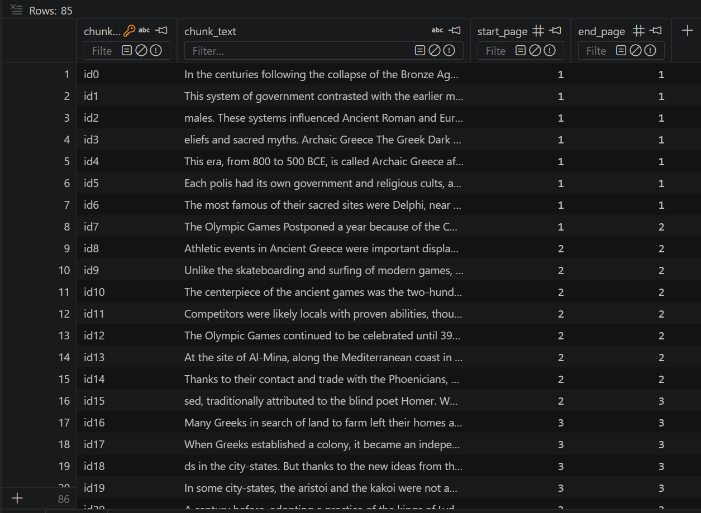
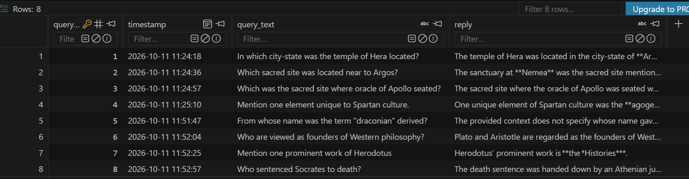
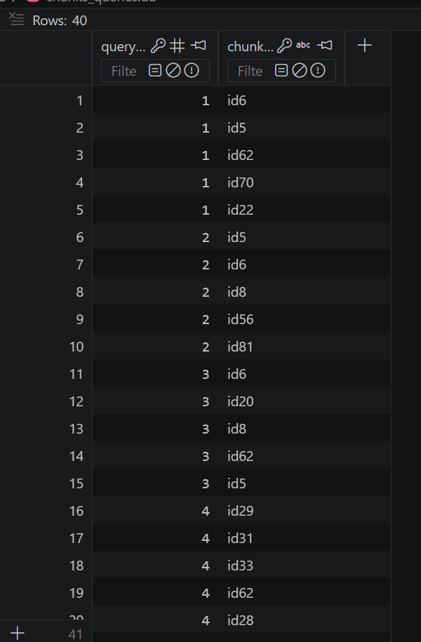
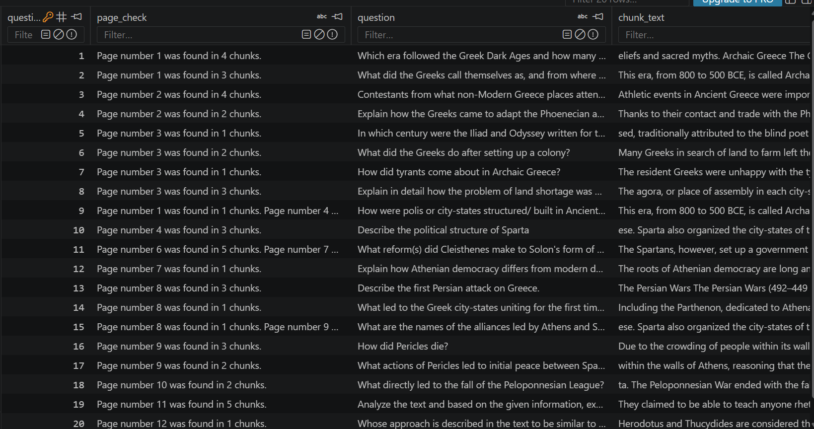
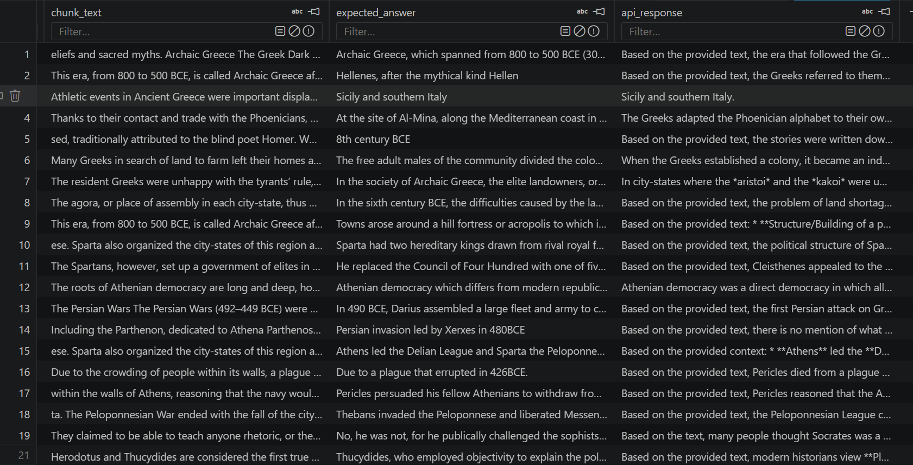

# RAG: PDF Question Answering and Evaluation

A from-scratch Retrieval-Augmented Generation (RAG) project, built with raw HTTP requests and no LangChain or LlamaIndex. It has two parts:

1. **A terminal PDF question-answering script (`pa.py`)** that lets you query any PDF in natural language.
2. **An evaluation script (`evals.py`)** that runs a fixed set of questions against a known document and records whether retrieval found the right pages, along with the model's answers for manual grading.

Both scripts share one pipeline (`pipeline.py`) for text extraction, chunking, embedding and retrieval, so the evaluation measures exactly the code the interactive tool uses.

## Project Structure

```
RAG/
├── pa.py                  # interactive PDF question answering
├── evals.py               # evaluation runner
├── pipeline.py            # shared extraction, chunking, embedding, retrieval
├── api_config.py          # shared API settings and chat() with retry logic
├── requirements.txt
├── openstax/              # evaluation document, questions and attribution
│   ├── eval_questions.json
│   ├── eval_results_ancient_greece.md
│   └── ATTRIBUTION.md
└── docs/                  # screenshots used in this README
```

---

# Part 1: PDF Question Answering (`pa.py`)

A terminal-based script that lets you query any PDF in natural language.

## Features
- Point the script at any PDF of your choice via the command line
- Sentence boundary chunking implemented from scratch, with page tracking so every chunk knows which page(s) it came from
- Embeddings generated locally using `sentence-transformers`, no additional API key needed
- Embeddings stored and retrieved using ChromaDB, running as a local file with no server needed
- Chunks, questions, answers and the chunks retrieved for each answer are stored in a local SQLite database
- Each query is stateless, so only the retrieved context and the current question are passed to the LLM
- Graceful error handling for rate limits, invalid API keys, and server errors with exponential backoff retry
- Streaming responses at readable speeds
- API key protected using a `.env` file via `python-dotenv`
- Error states handled cleanly using Python's `Enum` module
- Type `Bye` to exit the conversation gracefully. The response is hardcoded to save API tokens

## How to Run
1. Clone this repository
```bash
git clone https://github.com/ruhandave19/Projects.git
```
2. Create and activate a virtual environment
```bash
python -m venv .venv
source .venv/bin/activate   # macOS/Linux
.venv\Scripts\activate      # Windows
```
3. Navigate into the project root
```bash
cd Projects
cd RAG
```
4. Install dependencies
```bash
pip install -r requirements.txt
```
5. Sign up at https://console.groq.com and create a free API key
6. Create a file named `.env` in the project root and add:
```
GROQ_API_KEY=your_key_here
```
7. Run the script with a pdf of your choice
```bash
py pa.py path/to/your/document.pdf
```

## Example Output
```bash
Type 'Bye' to exit the conversation
Assistant: Hi there! I've received your PDF and loaded it up.
How can I help you with the document today?
User: What is the main topic of this document?
Assistant: Based on the provided context, the document discusses...
User: Bye
Assistant: Goodbye. It was nice talking to you!
```

## Database Tables
The script stores its data in three SQLite tables.

**`chunk_store`**: every chunk of the loaded PDF with its id, its text, and the first and last page it spans (`start_page`, `end_page`). It is written once when the PDF is indexed. The chunk ids match the ids stored in ChromaDB, which is what lets a retrieved chunk be traced back to its pages.



**`queries`**: one row per question asked, with a timestamp, the question and the model's reply. A row is saved only after a reply arrives, so failed API calls are never logged as answers.



**`query_chunks`**: a linking table between `queries` and `chunk_store`. Each question gets five rows, one per retrieved chunk. Foreign keys tie `query_id` to `queries` and `chunk_id` to `chunk_store`, so joining the three tables shows which passages each answer was based on.



---

# Part 2: Evaluation (`evals.py`)

A fixed set of 20 questions, each with a known answer and the page it comes from, run through the same pipeline as the interactive tool. The questions cover Section 6.2 ("Ancient Greece") of OpenStax's *World History, Volume 1*, and include single-fact lookups, multi-part answers, similar-sounding passages, and questions whose answers sit across a page boundary.

## How It Works
Two independent checks are kept separate on purpose, because they catch different failures:

- **Page check (automatic):** for each question, the pages of the five retrieved chunks are compared with the expected page. Most questions have a single expected page, and questions that straddle a page break have a range. This is instant, costs nothing, and tells you whether retrieval looked in the right place.
- **Answer check (manual):** the model's reply is read against a reference answer. A correct page does not guarantee a correct answer, so this stays a human judgement for now.

In the baseline run every question had at least one retrieved chunk on its expected page, yet several answers were still incomplete. Retrieval therefore passed where the answers failed, which is the reason the two checks are separate.

## Features
- 20 hand-written questions with expected pages, stored in `openstax/eval_questions.json`
- Reuses the shared pipeline from `pa.py`, so the evaluation exercises the same chunking and retrieval code
- Rebuilds a fresh index on every run, so results are never contaminated by a previous document
- Requests are spaced out and retried with backoff to stay within free-tier API limits
- Every run is logged to an `eval_runs` table in its own SQLite database
- Keeps the evaluation's database and ChromaDB store separate from the interactive tool's

## How to Run
1. Follow steps 1 to 4 of the PDF answering setup above (clone, virtual environment, project root, dependencies)
2. Sign up at https://aistudio.google.com/app/api-keys and create a free Gemini API key
3. Create a file named `.env` in the project root and add:
```
GEMINI_API_KEY=your_key_here
```
4. Run the evaluation
```bash
py evals.py
```
5. Inspect the results. The script writes an `eval_runs` table into a local SQLite database file, which you can open with [DB Browser for SQLite](https://sqlitebrowser.org/), a VS Code SQLite extension, or the `sqlite3` command line.

A full run takes a couple of minutes, since the requests are paced to respect the free-tier rate limit.

## Example Output
Results are logged to the `eval_runs` table, shown here in two parts because the table is wide.

**Page check, question and retrieved chunk text:**



**Retrieved chunk text, expected answer and the model's response:**



*Screenshots may show excerpts of* World History, Volume 1 *(OpenStax, CC BY-NC-SA 4.0). See [`openstax/ATTRIBUTION.md`](openstax/ATTRIBUTION.md).*

A readable report of one full run is in [`openstax/eval_runs.md`](openstax/eval_runs.md).

---

## Known Limitations
- **No semantic chunking.** Chunks are cut by size and sentence ending, not by meaning. Answers that span several chunks, or need a whole paragraph, can reach the model incomplete or missing context.
- **Fixed top-5 retrieval with no relevance cutoff.** Five chunks are always passed to the model, however relevant they are. Loosely related chunks can dilute the context, and a passage that mentions the right topic but not the answer can displace one that actually holds it.
- **The page check is coarse.** It shows that a retrieved chunk touches the expected page, not that the answer text was in the chunks or that the answer was correct. A chunk that straddles two pages is credited to both.
- **Answer correctness is graded by hand.** There is no automated or model-graded scoring yet.
- **The evaluation is small.** It has 20 questions, one document and one run per configuration. Model replies can vary between runs, so small differences in results are not meaningful.
- **Sentence detection is punctuation-only.** Chunk boundaries are placed after `.`, `!` or `?`, so abbreviations, decimals and quotations can produce awkward cuts. If no sentence ending is found nearby, the chunker falls back to a fixed-size cut.
- **Text extraction is plain text only.** There is no OCR for scanned PDFs, no table parsing, and no awareness of layout, so sidebars, captions and multi-column pages can interleave in the extracted text. The evaluation document was prepared as clean text to avoid this.
- **One document per run.** The index (the SQLite chunk table and the ChromaDB collection) is rebuilt from scratch every time, and the interactive tool's query history stores chunk ids that only make sense for the document indexed at that time.
- **Each question is answered independently.** There is no conversation memory, so follow-up questions that depend on earlier answers do not work.
- **Free-tier API limits.** The evaluation is paced to stay under the request limit, and results depend on the availability of the Gemini API.

## Debugging Notes
Problems found while building the evaluation, and how they were resolved:
- **Stale vector store.** Early evaluation runs looked like a chunking failure, but retrieval was returning chunks from a different, earlier document. The ChromaDB collection persisted between runs and the new chunks' ids collided with the old ones. The fix was to delete and recreate the collection at the start of every run.
- **Unbounded sentence-boundary search.** On a large document, the backward scan for a sentence ending could walk far past the start of a chunk and slow the chunker to a crawl. Both scans now have a limit and fall back to a fixed cut.
- **Page numbering.** PyMuPDF counts pages from zero, while the evaluation questions use the page numbers a reader sees, so pages are stored from one to keep the two aligned.

## Planned for v3.0
- Semantic chunking, improved retrieval, and temperature tuning
- LangChain, LlamaIndex

## Sources
The evaluation document is derived from OpenStax *World History, Volume 1*, licensed under CC BY-NC-SA 4.0. Full credit is in [`openstax/ATTRIBUTION.md`](openstax/ATTRIBUTION.md).